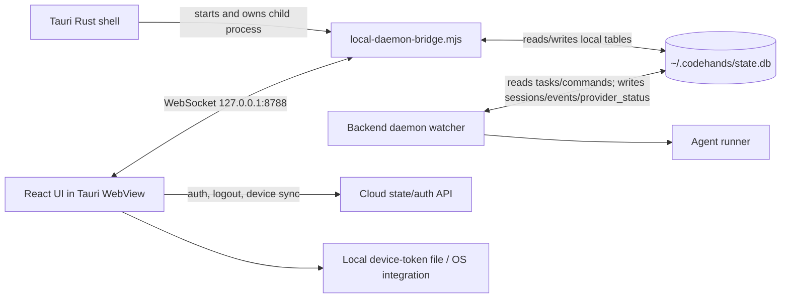

# CodeHands Desktop: Backend, Daemon, and Agent Runner Notes

This document records the current CodeHands desktop implementation: what has been built, how the desktop app connects to the local daemon, how tasks reach the agent runner, which process owns each responsibility, how to run it, and what is still incomplete.

## 1. Project Position

The desktop app is a Tauri 2 application with a React/Vite frontend. It is the local control surface for CodeHands AI:

- The user selects a local repository, writes a task, chooses an agent, and chooses a model.
- The desktop UI sends the task to a local WebSocket bridge.
- The bridge writes task and command records into the shared CodeHands SQLite database.
- The backend daemon watcher reads those records, creates sessions, runs the configured agent runner, and writes session/event results back into SQLite.
- The desktop UI receives the current database state through the bridge and renders sessions, events, statuses, diffs, logs, review actions, and project data.
- Cloud API access is used for account authentication, devices, and synchronization. Repository files and raw agent output are intended to remain local.

The main local database is:

```text
%USERPROFILE%\\.codehands\\state.db
```

On macOS/Linux, the equivalent home directory is used by Node's `homedir()` function.

## 2. High-Level Architecture



The controlling design rule is one writer per local table:

| Data | Writer | Desktop behavior |
| --- | --- | --- |
| `projects` | Desktop bridge | Creates or updates a project when a task is submitted |
| `tasks` | Desktop bridge | Inserts the requested task and phase model configuration |
| `commands` | Desktop bridge | Inserts approve, reject, stop, or resume commands |
| `sessions` | Backend daemon watcher | Desktop only reads these |
| `events` | Backend daemon watcher | Desktop only reads these |
| `provider_status` | Backend daemon watcher | Desktop only reads these |

The desktop app does not directly start Claude, Codex, or another agent CLI. The daemon watcher owns that operation.

## 3. Tauri Startup and Process Ownership

File: `src-tauri/src/lib.rs`

When Tauri starts, its `setup` callback runs:

```rust
Command::new("node")
    .arg("../local-daemon-bridge.mjs")
    .spawn()
```

The resulting child process is stored in Tauri application state as `Daemon(Mutex<Option<Child>>)`. When the desktop application exits, Tauri kills that child process.

This means the bridge is desktop-owned during development. It is not expected to be started manually in a second terminal when using `pnpm tauri dev`.

Current limitation: the Rust code assumes the relative path `../local-daemon-bridge.mjs` resolves correctly from the Tauri process working directory. If the app is launched from an unexpected working directory or packaged without adjusting this path, the child may fail to start. The current `.spawn().ok()` also hides the startup error from the UI.

## 4. Local Daemon Bridge

File: `local-daemon-bridge.mjs`

The bridge is the adapter between the React UI and the backend daemon's local database.

### Startup sequence

1. Resolve the backend daemon directory:
   - Default: `../codehands-backend/daemon` beside this desktop repository.
   - Override: `CODEHANDS_DAEMON_DIR`.
2. Verify that `<daemon>/migrations` exists.
3. Open SQLite at:
   - Default: `~/.codehands/state.db`.
   - Override: `CODEHANDS_DB`.
4. Enable SQLite WAL mode, foreign keys, and a 5-second busy timeout.
5. Create the local `schema_migrations` bookkeeping table if necessary.
6. Read and apply numbered SQL migration files from the backend daemon's `migrations` directory.
7. Start the backend watcher unless `CODEHANDS_START_DAEMON=false`.
8. Start a WebSocket server at `127.0.0.1:8788` unless overridden by `CODEHANDS_LOCAL_PORT`.
9. Broadcast the current state immediately and then every 900 milliseconds.

### Database state sent to the UI

The bridge queries:

- Projects, including repository path and session count.
- Provider status.
- Sessions joined to tasks and projects.
- Events grouped by session.
- Daemon watcher status.
- Agent runner availability and mode.

The initial state is sent to every WebSocket client as soon as it connects. The polling broadcast keeps the UI synchronized with changes written by the backend watcher.

### WebSocket commands

The React app sends JSON messages shaped like:

```json
{
  "type": "command",
  "commandType": "start",
  "requestId": "unique-request-id",
  "payload": {
    "repo": "D:\\dev\\some-repo",
    "task": "Describe the coding task",
    "agent": "codehands",
    "model": "claude-3-5-sonnet",
    "phaseModels": {
      "analyze": "claude-3-5-sonnet",
      "plan": "claude-3-5-sonnet",
      "implement": "qwen-2.5-coder",
      "test": "gpt-4o-mini",
      "review": "claude-3-5-sonnet"
    }
  }
}
```

For `start`, the bridge:

1. Validates repository, prompt, and agent.
2. Resolves the repository path.
3. Computes a project identity from the Git origin URL, or from the local path when no origin exists.
4. Creates or updates the `projects` row.
5. Inserts a `tasks` row with the requested agent and model configuration.
6. Returns an `accepted` response.
7. Stores the request ID until the watcher creates the corresponding session.
8. Sends a `session` message when the new session appears in the database.

For session actions, the bridge inserts a row into `commands`. The daemon later processes it and updates the session state. The desktop does not mutate the session status directly.

## 5. React Frontend Connection

Files: `src/App.tsx`, `src/components/NewTaskForm.tsx`

The frontend connects to:

```text
ws://127.0.0.1:8788
```

On WebSocket open, `connected` becomes true. On a `state` message, the app updates projects, sessions, provider statuses, events, and the daemon watcher state. If the socket closes, the app retries after two seconds.

The new-task form blocks submission while the bridge is disconnected. When submitted, it sends the task payload described above. The UI first shows that the task was accepted, then navigates to the task workspace when the daemon creates a session.

The task workspace supports these daemon commands:

- `approve`
- `reject`
- `stop`
- `resume`

The command is sent over WebSocket and becomes a database command row. The daemon is responsible for enforcing the valid session transition.

## 6. Backend Daemon and Agent Runner Flow

The intended execution flow is:

```text
User submits task
  -> desktop bridge inserts projects/tasks rows
  -> backend watcher notices the task
  -> watcher performs preflight/provider checks
  -> watcher creates a session
  -> watcher creates an isolated Git worktree when required
  -> watcher invokes the configured agent runner
  -> runner emits progress, file, command, test, cost, and error information
  -> watcher persists sessions/events/provider_status
  -> bridge reads the new rows
  -> React UI renders live status and results
```

The bridge starts the watcher with:

```text
<backend-daemon>/node_modules/tsx/dist/cli.mjs src/watcher.ts
```

The watcher receives an environment variable:

```text
CODEHANDS_FAKE=true|false
```

That value is derived from `CODEHANDS_RUNNER` in the bridge.

The bridge does not start the watcher if the backend daemon's `node_modules` directory is missing. In that case, the WebSocket bridge can still open and tasks can be queued, but no watcher will process them.

## 7. Runner Modes

### Fake runner mode

This is the default local mode:

```text
CODEHANDS_RUNNER=fake
```

Any value other than exactly `real` selects fake mode. The bridge reports a built-in demo runner with no Claude subscription requirement. This mode is intended for local demonstrations and does not require the Claude CLI.

### Real runner mode

Enable it with:

```powershell
$env:CODEHANDS_RUNNER = "real"
pnpm tauri dev
```

The bridge then checks the command in `CODEHANDS_CLAUDE_PATH`, defaulting to `claude`:

1. Runs `claude --version`.
2. Runs `claude auth status`.
3. Reports whether Claude is installed and authenticated.

The current real runner support is Claude Code. Codex and CodeHands options are present in the UI and contract types, but their real runner implementations are not complete in this desktop integration.

Override the Claude executable with:

```powershell
$env:CODEHANDS_CLAUDE_PATH = "C:\\path\\to\\claude.exe"
```

## 8. Legacy Fake Daemon

File: `fake-daemon.mjs`

This is an older standalone demo server. It listens on `ws://localhost:8787`, seeds in-memory sessions, emits scripted events, and does not use SQLite or the backend watcher.

It supports a simplified flow for start, approve, reject, and stop. It is useful as historical/demo code, but it is not started by the current Tauri app. The current integration uses `local-daemon-bridge.mjs` on port 8788 instead.

## 9. Cloud API and Authentication

File: `src/api/cloud.ts`

The cloud client defaults to:

```text
http://localhost:3000
```

Override it at Vite build/dev time with:

```text
VITE_CLOUD_URL=http://localhost:3000
```

Supported operations include:

- Sign up: `POST /auth/signup`
- Login: `POST /auth/login`
- Logout: `POST /auth/logout`
- List devices: `GET /devices`
- Revoke device: `POST /devices/:id/revoke`
- Push sync changes: `POST /sync/push`
- Pull sync changes: `GET /sync/pull?cursor=...`
- Health check: `GET /health`

The desktop restores the device token during startup and calls `cloudApi.setToken`. Expired tokens open the authentication modal. Logout clears the cloud token, local metadata, and the local token storage.

## 10. Device Token Storage

Files: `src/services/keychain.ts`, `src-tauri/src/lib.rs`

The current Tauri implementation stores the device token in:

```text
%USERPROFILE%\\.codehands\\device_token
```

The frontend calls Tauri commands when `window.__TAURI_INTERNALS__` is available:

- `save_device_token`
- `get_device_token`
- `delete_device_token`

When running in a regular browser, the frontend falls back to `localStorage` key `codehands_device_token`.

The signed-in metadata is stored separately in `localStorage` under:

- `codehands_auth_meta`
- `codehands_user_profile`

The current code uses a local file fallback rather than a dedicated Tauri keyring/stronghold plugin. That should be treated as a security-hardening item before production release.

## 11. Environment Variables

| Variable | Default | Purpose |
| --- | --- | --- |
| `CODEHANDS_DAEMON_DIR` | `../codehands-backend/daemon` | Backend daemon directory containing migrations and watcher |
| `CODEHANDS_DB` | `~/.codehands/state.db` | Shared local SQLite database path |
| `CODEHANDS_LOCAL_PORT` | `8788` | Desktop bridge WebSocket port |
| `CODEHANDS_START_DAEMON` | enabled | Set to `false` to disable watcher startup |
| `CODEHANDS_RUNNER` | `fake` | Select fake or real runner mode |
| `CODEHANDS_CLAUDE_PATH` | `claude` | Executable used in real Claude runner mode |
| `VITE_CLOUD_URL` | `http://localhost:3000` | Cloud auth/state API URL |

## 12. Directory and File Map

| Path | Responsibility |
| --- | --- |
| `src/App.tsx` | Main React shell, WebSocket connection, task/command dispatch, auth restoration |
| `src/components/NewTaskForm.tsx` | Repository, prompt, agent, model, and phase routing form |
| `src/components/TaskDetail.tsx` | Session/event data types and task details |
| `src/components/ModernWorkspace.tsx` | Live task workspace and session actions |
| `src/components/SplashScreen.tsx` | Startup splash UI |
| `src/services/keychain.ts` | Tauri token commands with browser fallback |
| `src/api/cloud.ts` | Cloud auth, device, sync, and health API client |
| `local-daemon-bridge.mjs` | SQLite adapter, migration runner, watcher launcher, WebSocket server |
| `fake-daemon.mjs` | Legacy in-memory demo daemon on port 8787 |
| `src-tauri/src/lib.rs` | Native Tauri shell and bridge process lifecycle |
| `src-tauri/tauri.conf.json` | Tauri application configuration |
| `vite.config.ts` | Vite/Tauri dev server on port 1420 |
| `README.md` | Product architecture, setup, and contract boundaries |
| `REDESIGN_IMPLEMENTATION_REPORT.md` | UI redesign and screen implementation report |

## 13. Development Commands

Install frontend dependencies:

```powershell
pnpm install
```

Run the desktop app:

```powershell
pnpm tauri dev
```

Build the frontend:

```powershell
pnpm build
```

The project expects Node 22.5+, pnpm, Rust, and the Windows Tauri prerequisites including Visual Studio C++ build tools. The sibling repositories are expected under `D:\dev` in the current setup:

```text
D:\dev\desktop
D:\dev\codehands-backend
D:\dev\codehands-contracts
```

Before a real daemon run, install dependencies in the backend daemon repository so this path exists:

```text
D:\dev\codehands-backend\daemon\node_modules
D:\dev\codehands-backend\daemon\node_modules\tsx\dist\cli.mjs
```

## 14. Current Verification

The frontend currently passes:

```text
tsc
vite build
```

The production build bundles the React application and logo asset successfully.

The splash screen issue was fixed in `src/App.tsx`: the `onFinish` callback is memoized with `useCallback`. Previously, every startup state update created a new callback, which reset the splash timer because `SplashScreen` watches `onFinish` in its effect dependencies.

## 15. Known Gaps and Risks

1. Tauri bridge startup errors are swallowed by `.spawn().ok()`. The UI can show disconnected status without explaining why the bridge failed.
2. The bridge uses a relative Node script path. Packaged-app path resolution still needs a production-safe implementation.
3. The bridge can queue tasks when watcher dependencies are missing, but those tasks will remain unprocessed.
4. The current desktop status only receives the broad watcher state from the bridge. More detailed startup and watcher failure diagnostics would improve supportability.
5. The token storage implementation is a local file, despite the architectural goal of OS keychain storage.
6. The cloud sync client exists, but the main startup path currently restores local auth metadata; a complete periodic local/cloud synchronization loop still needs to be connected.
7. Real runner support is currently centered on Claude Code. Codex and CodeHands UI choices should remain disabled or clearly marked until their runner paths are implemented.
8. The README contains both the earlier stand-in architecture description and the newer bridge integration notes. The bridge behavior described in this document follows the current `local-daemon-bridge.mjs` and Tauri code.
9. No automated end-to-end test currently verifies the full chain: task form -> WebSocket -> SQLite -> watcher -> runner -> session/event update -> UI.

## 16. Recommended Next Debugging Checks

When the app appears disconnected or tasks remain queued:

1. Confirm the backend daemon clone exists at `../codehands-backend/daemon` or set `CODEHANDS_DAEMON_DIR`.
2. Confirm the daemon `migrations` directory exists.
3. Confirm daemon dependencies and `tsx` are installed.
4. Check whether port 8788 is already occupied.
5. Inspect the terminal that launched `pnpm tauri dev` for bridge startup output.
6. Confirm the database exists at `%USERPROFILE%\\.codehands\\state.db`.
7. Use the UI daemon indicator and browser/WebView console to verify the WebSocket reaches `127.0.0.1:8788`.
8. If using real mode, run `claude --version` and `claude auth status` in the same environment used to launch Tauri.
