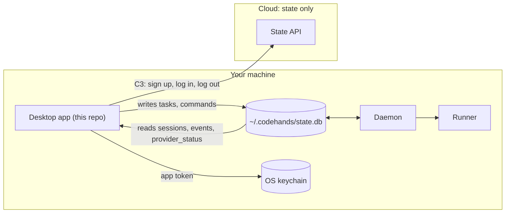

# codehands-desktop

The Code Hands AI desktop app: the window where you pick a repo, describe a task, choose the agent and the model for each phase, watch the work happen live, read the change, and approve or reject it.

It is the main way people use Code Hands AI. Everything a task needs runs on the same machine as the app.

**Owner:** Tania
**Contracts:** L1 (local DB), C3 (cloud API), C5 (sessions) in [codehands-contracts](https://github.com/devweekends/codehands-contracts)
**Part of:** [Code Hands AI](https://github.com/devweekends/codehands-docs). Read the design in that README first.
**Status:** not started. This repo has no code yet. This README describes what the app must do and how it fits, so it can be built against stand-ins from day one.

## Where it sits

The app never talks to the runner and never runs a task itself. It writes what the person wants into the local database, and reads back what happened. The daemon does the work.



### The one rule that shapes the app

**One writer per local table.** The app writes `tasks` and `commands`, and nothing else. The daemon writes `sessions`, `events` and `provider_status`, including the rows that sync down from another machine.

So every action in the app becomes a row:

| The person | The app writes | The daemon then |
| --- | --- | --- |
| Starts a task | A `tasks` row: project, prompt, agent, model per phase | Runs preflight checks, creates the session, calls the runner |
| Stops a running task | A `stop` command | Stops the runner. Status becomes `stopped` |
| Resumes it | A `resume` command, with an optional new prompt | Resumes in the same worktree |
| Approves the change | An `approve` command with a commit message | Commits on the task's branch. Status becomes `approved` |
| Rejects it | A `reject` command | Deletes the worktree and branch. Status becomes `rejected` |

The app shows the result by reading `sessions` and `events`. It never changes a status directly.

## What it does

| Area | Behaviour |
| --- | --- |
| Sign up and log in | Against the cloud state API (C3). The token goes into the OS keychain, never a file. Logging out revokes only this machine's token |
| Signed-in state | On sign-in, the daemon pulls your sessions, memory and preferences, so a second machine looks like the first |
| Projects | Add a repo by picking a folder. A project is identified by a hash of its origin URL, so the same repo on another machine is the same project |
| New task | Prompt, agent (Claude Code or Codex), and a model per phase. Defaults come from your preferences |
| Session list | Every session with its status, agent, cost and time |
| Live view | Events as they arrive: messages, files read and changed, commands and their output, test results, cost |
| Diff and approve | The full change, file by file. Approve with a commit message, or reject |
| Provider problems | Clear messages for each failure state (below), before a task starts and while it runs |
| Restart | Comes back exactly as you left it |

### Session statuses

The seven statuses and their legal moves come from `@codehands/contracts`. Use `canTransition()` to decide which buttons to show, so the app never offers a move the daemon will refuse.

| Status | Show | Actions |
| --- | --- | --- |
| `queued` | Waiting to start | |
| `running` | Live events | Stop |
| `stopped` | Where it stopped | Resume |
| `awaiting_approval` | The diff and its summary | Approve, Reject |
| `approved` | The branch and commit to merge | |
| `rejected` | That the change was discarded | |
| `failed` | The reason from `task.failed` | |

### Provider failures

The daemon checks these before starting a task and the runner reports them during one, as a `provider_status` row and a `provider.status` event. The app turns each into something the person can act on:

| State | The app shows |
| --- | --- |
| `rate_limited` | When it can retry, and offers the other agent |
| `auth_expired` | Sign in to that agent again on this machine |
| `usage_limit` | When the plan's cap resets |
| `subscription_inactive` | That the agent is unavailable |
| `down` | That the provider is down |

### What it never does

- Store an API key, agent login or the app token anywhere but the OS keychain.
- Send repo files, credentials or raw agent output to the cloud.
- Write to `sessions`, `events` or `provider_status`.
- Start the agent CLIs or touch git itself.

## Stack

| Piece | Choice | Why |
| --- | --- | --- |
| Shell | [Tauri 2](https://v2.tauri.app/) | A small native binary, and the Rust side can reach the keychain and the local database |
| UI | React with Vite, TypeScript | Shared with the rest of the team, fast reloads |
| Local data | `~/.codehands/state.db` (SQLite), table types from contract L1 | The daemon owns the schema and migrations |
| Secrets | Tauri's keyring or stronghold plugin | The OS keychain on macOS, Windows and Linux |
| Logs and terminal output | xterm.js | Thousands of lines a second without dropped frames |

## Building it without waiting for anyone

Every part the app depends on ships a stand-in, so the app can be built and demoed on its own:

| Depends on | Stand-in | Swap for the real one when |
| --- | --- | --- |
| The daemon writing sessions and events (L1) | A fake writer that fills `sessions` and `events`, and `codehands task add` | The daemon reads `tasks` and runs them |
| The cloud API (C3) | A mock server with accounts in memory | The state API is hosted |
| Session data (C5) | Sample rows | Real runs |

Swap one stand-in at a time on a Friday. If something breaks, write it down and keep the stand-in.

## Getting started

You need Node 22, pnpm 10, the Rust toolchain (`rustup`), and the [Tauri prerequisites](https://v2.tauri.app/start/prerequisites/) for your OS.

```bash
git clone https://github.com/devweekends/codehands-contracts.git
git clone https://github.com/devweekends/codehands-desktop.git
cd codehands-contracts && pnpm install && pnpm build
```

The first commit scaffolds the app with `pnpm create tauri-app` (React, TypeScript, Vite) and adds the contracts:

```jsonc
// while building against it side by side
"@codehands/contracts": "file:../codehands-contracts"
// once tagged
"@codehands/contracts": "github:devweekends/codehands-contracts#v0.1.0"
```

After that, update this section with the real commands (`pnpm tauri dev`, the stand-in switch, how to point at a local mock server), and the layout of `src/` and `src-tauri/`.

## Roadmap

| When | Milestone |
| --- | --- |
| Month 1 | The whole loop from the app: pick a repo, start a task, watch it live, read the diff, approve. Keys in the keychain. Which model did each step |
| Month 2 | Model per phase in the task form, cost on screen |
| Month 3 | Diff and artifact viewers, memory viewer, used daily by the team |
| Month 5 | Devices list with revoke, the same account on a second machine |
| Month 6 | Signed installers for macOS, Windows and Linux, updates in place |

Details are in the [plan](https://github.com/devweekends/codehands-docs/blob/main/plan/six-month-sig-build-plan.md) under *SIG Product*.

## Contributing

- One branch per Linear issue, the issue id in the PR title.
- `main` is always green. CI runs build and test on every PR.
- Anything the app needs from another part (a new column, a new event field) is a contract change: open it in [codehands-contracts](https://github.com/devweekends/codehands-contracts#changing-a-contract).


## Run

```
pnpm install
pnpm tauri dev
```

Requires Node, pnpm, and Rust (with the Visual Studio C++ build tools on Windows).

In dev, the app starts `fake-daemon.mjs` itself. It is temporary and will be replaced by the real daemon from codehands-server.
